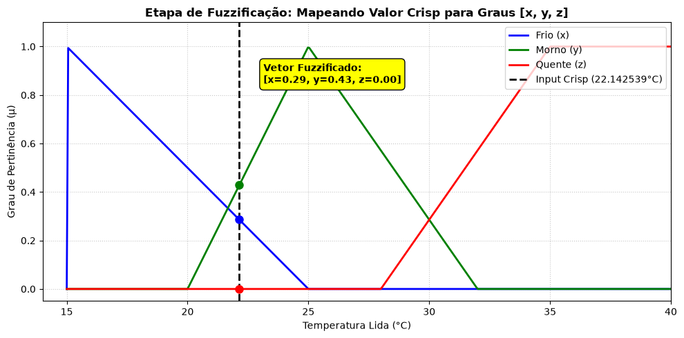
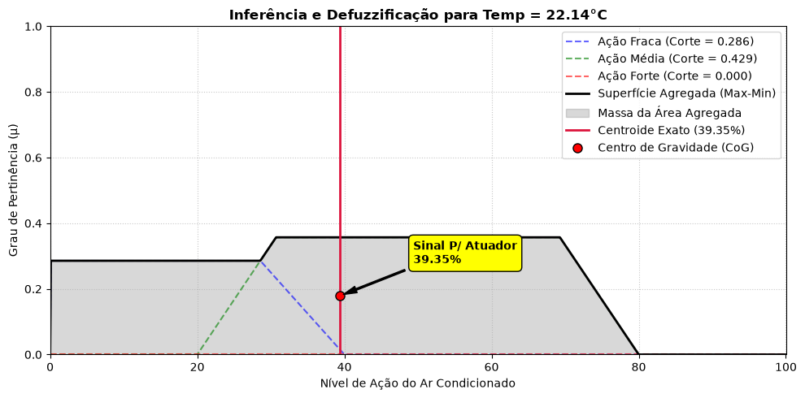

# Grupo_4_GSA_-_Logica_Fuzzy
Repositório destinado para a organização das 200 simulações estocásticas LHS e refinamento das funções u(x).

Relatório Instrumentalização grupo 4

Nome equipe: Juan, Monaliza, Gabriel Braga, Marcos

Assuntos - 

## Planejamento

O objetivo do trabalho é transformar dados de temperatura e umidade em uma
decisão de controle adequada para um microcontrolador. A proposta planeja:

1. Uma base de dados gerada por simulações do virtual do Grupo 2
2. amostragem por Hipercubo Latino para cobrir o espaço de entradas com poucas
   simulações
3. funções de pertinência para representar conceitos linguísticos, como
   temperatura fria, morna ou quente para melhor "aproximação"
4. inferência fuzzy para calcular o nível de atuação do sistema de
   climatização e defuzzificação por centroide para obter um sinal numérico entre 0% e 100%.

O processo é planejado para a situação de como o microcontrolador deva se comportar com a entrada bruta de dados e como deverá agir sabendo que requitos indefinidos e subjetivos como  o que se considera "confontável". Onde com esse dado de entrada passando por uma fuzzificação para deixar-lo com níveis de intenciadade de uma característica e com uso das regras fuzzy, encontrar o valor satisfatório dentro das regras, onde poderá ser representado para o microcontrolador como um valor de intensidade linear. 

Sensor -> filtragem -> fuzzificação -> regras fuzzy -> agregação -> centroide -> MQTT

## Desenvolvimento

A tabela de saída usada diretamente no protótipo fuzzy está em 'eplusout.sql', onde foi extraida e transfigurada para
[`banco_dados_lhs_200.csv`](/Projeto/Data/banco_dados_lhs_200.csv), conténdo 200 pares de:

- `LHS_Temperatura_C`;
- `LHS_Umidade_%`.

As amostras dessa tabela foram geradas com `scipy.stats.qmc.LatinHypercube`,
com duas variáveis e semente 42, escaladas para os limites físicos obtidos da
simulação-base. Portanto, elas são adequadas para testar o controlador em
diversas combinações de temperatura e umidade.

### 3.1 Geração do Hipercubo Latino

O LHS divide o intervalo de cada variável em estratos e seleciona uma amostra
de cada estrato, combinando as dimensões de forma aleatória. Diferentemente de
sortear todos os pontos livremente, essa estratégia reduz a concentração de
amostras em uma mesma região e permite explorar o espaço de entrada com 200
simulações.

No projeto, o notebook
[`Teste_Fuzzy.ipynb`](/Projeto/Teste_Fuzzy.ipynb) registra duas etapas:

1. geração da matriz LHS com os parâmetros de simulação
   (`temp_setpoint`, `potencia_equip`, `taxa_infiltracao` e
   `n_ocupantes`);
2. geração de 200 pares de temperatura e umidade a partir dos limites da simulação-base.


### 3.2 Fuzzificação

Para a temperatura, foram definidos os conjuntos:

- **Fria:** triangular `[15, 15, 25]`;
- **Morna:** triangular `[20, 26, 32]`;
- **Quente:** trapezoidal `[28, 35, 45, 45]`.

Para a umidade relativa:

- **Seca:** triangular `[0, 0, 40]`;
- **Ideal:** triangular `[30, 50, 70]`;
- **Úmida:** trapezoidal `[60, 80, 100, 100]`.

Cada leitura numérica é convertida em graus de pertinência entre 0 e 1. A
implementação atual usa funções triangulares e trapezoidais próprias, o que
facilita portar o cálculo para C/C++.

### 3.3 Inferência e defuzzificação

O protótipo usa composição de Zadeh:

- operador **E**: mínimo entre os graus de pertinência;
- agregação das regras: máximo;
- saída: nível de atuação do ar-condicionado de 0% a 100%;
- defuzzificação: centroide.

Uma base inicial de regras é:

| Regra | Condição | Saída |
|---|---|---|
| 1 | Se temperatura é fria **e** umidade é ideal | atuação fraca |
| 2 | Se temperatura é morna **e** umidade é úmida | atuação média |
| 3 | Se temperatura é quente **e** umidade é seca | atuação forte |

Essa base é um ponto de partida. Ela deve ser ampliada após ensaios, pois
combinações como “quente e úmida” também precisam produzir uma resposta
coerente de conforto e controle.

O centroide é calculado por:

```text
saida = soma(nivel * pertinencia_agregada(nivel))
        / soma(pertinencia_agregada(nivel))
```


Se nenhuma regra for ativada, o algoritmo deve tratar o denominador nulo e
usar uma saída segura previamente definida, em vez de executar uma divisão por
zero.

### 3.4 Algoritmo previsto para o microcontrolador

```text
inicializar_sensor()
inicializar_saida_pwm()

repetir a cada periodo:
    temperatura, umidade = ler_sensor()

    se leitura_invalida(temperatura, umidade):
        aplicar_saida_segura()
        continuar

    t_frio, t_morno, t_quente = fuzzificar_temperatura(temperatura)
    u_seca, u_ideal, u_umida = fuzzificar_umidade(umidade)

    r1 = minimo(t_frio,   u_ideal)
    r2 = minimo(t_morno,  u_umida)
    r3 = minimo(t_quente, u_seca)

    saida = centroide(r1, r2, r3)
    saida = limitar(saida, 0, 100)
    escrever_pwm(saida)
```

Para reduzir oscilações do atuador, recomenda-se acrescentar histerese ou
limitar a variação máxima da saída entre dois ciclos. A frequência de leitura,
o período de acionamento e os limites de segurança serão definidos conforme o
sensor e o atuador escolhidos.

### 3.5 Demosntração grafica de Temperatura separada de umidade




## 4. Problemas encontrados

1. **Diferença entre as bases:** a matriz LHS de quatro parâmetros representa
   entradas da simulação de temperatura e umidade apenas.  É necessário documentar claramente se a primeira
   será usada apenas para gerar cenários ou se suas saídas serão incorporadas
   ao treinamento/validação. É também notado que no relatório .html recebido pelo grupo 2 que há referencias sobre o consumo gerado pelos ventiladores da sala, mas não há dados prontos para a geração de calor produzida para adicionar a complexidade do algoritmo.


2. **Protótipo ainda não embarcado:** o notebook depende de Python, NumPy,
   SciPy, Matplotlib e scikit-fuzzy. Essas dependências não devem ser levadas
   diretamente para o microcontrolador. E caso seja proposto a Programação e processamento desses dados exclusivamente via serviço de outra maquina, deverá tera contato com o grupo 3 sobre.

3. **Regras incompletas:** a implementação registrada contém três regras
   iniciais e não cobre todas as nove combinações entre os três conjuntos de
   temperatura e os três de umidade, está em processo sobre como interpretaremos as variaveis de temperatura e umidade como complementares, ou distintas uma da outra.

4. **Validação física pendente:** ainda não há, no material atual, identificação
   definitiva do sensor, da placa, do atuador nem ensaios comparando o comando
   fuzzy com uma referência de conforto.

## 5. O que estamos trabalhando no momento, de ordem prioritária.

1. Completar a tabela de regras fuzzy e revisar os limiares com o grupo 3 e com
   os dados de conforto, de forma mais confortável ao envio do json.

2. Criar testes automatizados para pontos frios, confortáveis, quentes,
   secos, ideais, úmidos e para entradas fora da faixa.

3. Testar primeiro com valores simulados e depois com o sensor real, registrando
   temperatura, umidade, a influencia da sala com onúmero de pessoas presentes, saída fuzzy e estado do atuador.

4. Ajustar os parâmetros após os ensaios e documentar os resultados finais,
   incluindo limitações e possíveis trabalhos futuros.

## Conclusão

O projeto já possui uma base de 200 amostras LHS e um protótipo funcional de
fuzzificação, inferência e defuzzificação por centroide. A próxima etapa não é
gerar uma nova metodologia, mas consolidar as duas bases, completar as regras e
validar a equivalência entre o protótipo Python e o algoritmo executado no
microcontrolador. Com essa validação, a leitura contínua de temperatura e
umidade poderá ser convertida em um comando de controle simples, interpretável
e adequado a recursos embarcados.

## Versão modular

A versão reutilizável do controlador está em
[`Projeto/fuzzy_controller.py`](Projeto/fuzzy_controller.py). O notebook
[`Projeto/Teste_Fuzzy_Modular.ipynb`](Projeto/Teste_Fuzzy_Modular.ipynb) apenas
importa o módulo e demonstra a temperatura usada nos exemplos.

Para calcular o centroide diretamente no terminal:

```bash
python Projeto/scripts/gerar_centroide.py 22.142539
```

O script também grava o payload MQTT em `centroide.json`. 

```bash
python Projeto/scripts/gerar_centroide.py 22.142539 \
  --output payload.json --json-only
```

O payload contém `temperature_c`, os graus de pertinência, as ativações das
regras e `centroid_percent`, pronto para ser enviado como mensagem MQTT:

```json
{
  "temperature_c": 22.142539,
  "membership": {
    "cold": 0.2857461,
    "warm": 0.4285078,
    "hot": 0.0
  },
  "activation": {
    "weak": 0.2857461,
    "medium": 0.4285078,
    "strong": 0.0
  },
  "centroid_percent": 40.33
}
```