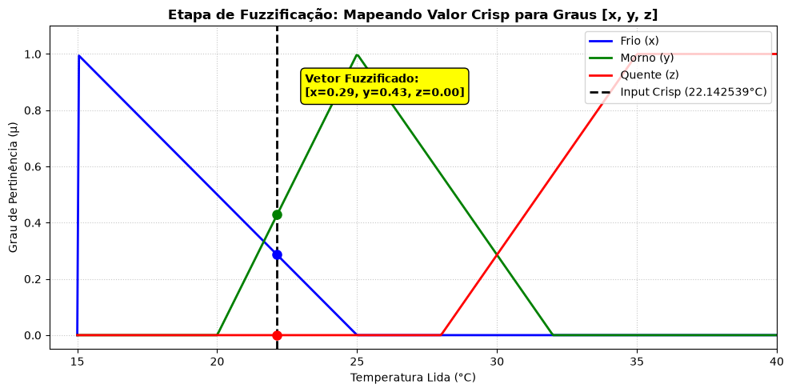
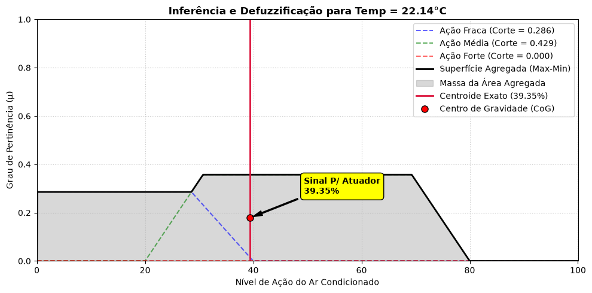

# Grupo_4_GSA_-_Logica_Fuzzy
Repositório destinado para a organização das 200 simulações estocásticas LHS e refinamento das funções u(x).

Relatório Instrumentalização grupo 4

Nome equipe: Juan, Monalisa, Gabriel Braga, Marcos

Assuntos - 

## Planejamento

O objetivo do trabalho é transformar dados de temperatura e umidade em uma
decisão de controle adequada para um microcontrolador. A proposta planeja:

1. Uma base de dados gerada por simulações do virtual do Grupo 2
2. amostragem por Hipercubo Latino para cobrir o espaço de entradas com poucas
   simulações
3. funções de pertinência para representar conceitos linguísticos, como
   temperatura fria, morna ou quente para melhor "aproximação"
4. inferência fuzzy para calcular o nível de atuação do sistema de
   climatização e defuzzificação por centroide para obter um sinal numérico entre 0% e 100%.

O processo é planejado para a situação de como o microcontrolador deva se comportar com a entrada bruta de dados e como deverá agir sabendo que requitos indefinidos e subjetivos como  o que se considera "confontável". Onde com esse dado de entrada passando por uma fuzzificação para deixar-lo com níveis de intenciadade de uma característica e com uso das regras fuzzy, encontrar o valor satisfatório dentro das regras, onde poderá ser representado para o microcontrolador como um valor de intensidade linear. 

Sensor -> filtragem -> fuzzificação -> regras fuzzy -> agregação -> centroide -> MQTT

## Desenvolvimento

A tabela de saída usada diretamente no protótipo fuzzy está em 'eplusout.sql', onde foi extraida e transfigurada para
[`banco_dados_lhs_200.csv`](/Projeto/Data/banco_dados_lhs_200.csv), conténdo 200 pares de:

- `LHS_Temperatura_C`;
- `LHS_Umidade_%`.

As amostras dessa tabela foram geradas com `scipy.stats.qmc.LatinHypercube`,
com duas variáveis e semente 42, escaladas para os limites físicos obtidos da
simulação-base. Portanto, elas são adequadas para testar o controlador em
diversas combinações de temperatura e umidade.

### 3.1 Geração do Hipercubo Latino

O LHS divide o intervalo de cada variável em estratos e seleciona uma amostra
de cada estrato, combinando as dimensões de forma aleatória. Diferentemente de
sortear todos os pontos livremente, essa estratégia reduz a concentração de
amostras em uma mesma região e permite explorar o espaço de entrada com 200
simulações.

No projeto, o notebook
[`Teste_Fuzzy.ipynb`](/Projeto/Teste_Fuzzy.ipynb) registra duas etapas:

1. geração da matriz LHS com os parâmetros de simulação
   (`temp_setpoint`, `potencia_equip`, `taxa_infiltracao` e
   `n_ocupantes`);
2. geração de 200 pares de temperatura e umidade a partir dos limites da simulação-base.


### 3.2 Fuzzificação

Para a temperatura, foram definidos os conjuntos:

- **Fria:** triangular `[15, 15, 25]`;
- **Morna:** triangular `[20, 26, 32]`;
- **Quente:** trapezoidal `[25, 45, 45, 45]`, saturando em 45 °C.

Os conjuntos de umidade abaixo são referência para uma etapa futura e não
participam do controlador atual:

- **Seca:** triangular `[0, 0, 40]`;
- **Ideal:** triangular `[30, 50, 70]`;
- **Úmida:** trapezoidal `[60, 80, 100, 100]`.

Cada leitura numérica é convertida em graus de pertinência entre 0 e 1. O
centroide é calibrado para retornar 0% até 15 °C e 100% a partir de 45 °C,
com resposta não decrescente entre esses limites.

### 3.3 Inferência e defuzzificação

O controlador atual usa temperatura e composição de Zadeh:

- operador **E**: mínimo entre os graus de pertinência;
- agregação das regras: máximo;
- saída: nível de atuação do ar-condicionado de 0% a 100%;
- defuzzificação: centroide.

Uma base inicial de regras é:

| Regra | Condição | Saída |
|---|---|---|
| 1 | Temperatura fria | atuação fraca |
| 2 | Temperatura morna | atuação média |
| 3 | Temperatura quente | atuação forte |

As regras não usam umidade. A escala do centroide é calibrada para que
temperaturas até 15 °C resultem em 0% e temperaturas a partir de 45 °C em
100%.

O centroide é calculado por:

```text
saida = soma(nivel * pertinencia_agregada(nivel))
        / soma(pertinencia_agregada(nivel))
```


Se nenhuma regra for ativada, o algoritmo deve tratar o denominador nulo e
usar uma saída segura previamente definida, em vez de executar uma divisão por
zero.

### 3.4 Algoritmo previsto para o microcontrolador

```text
inicializar_sensor()
inicializar_saida_pwm()

repetir a cada periodo:
    temperatura = ler_sensor()

    se leitura_invalida(temperatura):
        aplicar_saida_segura()
        continuar

    t_frio, t_morno, t_quente = fuzzificar_temperatura(temperatura)
    r1 = t_frio
    r2 = t_morno
    r3 = t_quente

    saida = centroide(r1, r2, r3)
    saida = limitar(saida, 0, 100)
    escrever_pwm(saida)
```

Para reduzir oscilações do atuador, recomenda-se acrescentar histerese ou
limitar a variação máxima da saída entre dois ciclos. A frequência de leitura,
o período de acionamento e os limites de segurança serão definidos conforme o
sensor e o atuador escolhidos.

### 3.5 Demosntração grafica de Temperatura separada de umidade




## 4. Problemas encontrados

1. **Diferença entre as bases:** a matriz LHS de quatro parâmetros representa
   entradas da simulação de temperatura e umidade apenas.  É necessário documentar claramente se a primeira
   será usada apenas para gerar cenários ou se suas saídas serão incorporadas
   ao treinamento/validação. É também notado que no relatório .html recebido pelo grupo 2 que há referencias sobre o consumo gerado pelos ventiladores da sala, mas não há dados prontos para a geração de calor produzida para adicionar a complexidade do algoritmo.


2. **Protótipo ainda não embarcado:** o notebook depende de Python, NumPy,
   SciPy, Matplotlib e scikit-fuzzy. Essas dependências não devem ser levadas
   diretamente para o microcontrolador. E caso seja proposto a Programação e processamento desses dados exclusivamente via serviço de outra maquina, deverá tera contato com o grupo 3 sobre.

3. **Regras incompletas:** a implementação registrada contém três regras
   iniciais e não cobre todas as nove combinações entre os três conjuntos de
   temperatura e os três de umidade, está em processo sobre como interpretaremos as variaveis de temperatura e umidade como complementares, ou distintas uma da outra.

4. **Validação física pendente:** ainda não há, no material atual, identificação
   definitiva do sensor, da placa, do atuador nem ensaios comparando o comando
   fuzzy com uma referência de conforto.

## 5. O que estamos trabalhando no momento, de ordem prioritária.

1. Completar a tabela de regras fuzzy e revisar os limiares com o grupo 3 e com
   os dados de conforto, de forma mais confortável ao envio do json.

2. Criar testes automatizados para pontos frios, confortáveis, quentes,
   secos, ideais, úmidos e para entradas fora da faixa.

3. Testar primeiro com valores simulados e depois com o sensor real, registrando
   temperatura, umidade, a influencia da sala com onúmero de pessoas presentes, saída fuzzy e estado do atuador.

4. Ajustar os parâmetros após os ensaios e documentar os resultados finais,
   incluindo limitações e possíveis trabalhos futuros.

## Conclusão

O projeto já possui uma base de 200 amostras LHS e um protótipo funcional de
fuzzificação, inferência e defuzzificação por centroide. A próxima etapa não é
gerar uma nova metodologia, mas consolidar as duas bases, completar as regras e
validar a equivalência entre o protótipo Python e o algoritmo executado no
microcontrolador. Com essa validação, a leitura contínua de temperatura e
umidade poderá ser convertida em um comando de controle simples, interpretável
e adequado a recursos embarcados.

## Execução do controlador

O cálculo fuzzy reutilizável está em
[`Projeto/src/fuzzy_system/fuzzy.py`](Projeto/src/fuzzy_system/fuzzy.py), e a
orquestração do processamento está em
[`Projeto/src/fuzzy_system/controller.py`](Projeto/src/fuzzy_system/controller.py).
A API e seu processamento periódico estão em
[`Projeto/src/api/app.py`](Projeto/src/api/app.py), com os adaptadores de
InfluxDB e MQTT em `Projeto/src/comunicacao/`. A cada 150 s, a API consulta os
últimos 150 s da medição `sensores`, campo `temp`, no bucket de origem `wsn`,
filtrando os nós `node` 3 e 4 e a tag `topic=wsn/central/sensores`. Para
cada nó, usa a temperatura mais recente dentro da janela, calcula a média
quando ambos possuem leitura, aplica o fuzzy e grava a temperatura média e o
centroide no bucket de saída `teste`. O campo `centroid_percent` também é
gravado no bucket `wsn`, na medição `fuzzy_result`. Se faltar leitura recente
de qualquer nó, nada é gravado.
Para depuração, a consulta imprime no terminal as tags, timestamp e temperatura
de cada registro retornado, além dos valores aceitos para os nós 3 e 4. Também
consulta o campo `umid` e imprime a média de umidade recente dos nós disponíveis;
esse valor é apenas para depuração e não altera o fuzzy nem é gravado no bucket.
Para executar a API a partir da raiz do repositório:

```bash
source .venv/bin/activate
python -m uvicorn api.app:app --app-dir Projeto/src --reload
```

O módulo `teste_API` continua disponível como ponto de entrada legado.

O token do InfluxDB é lido de `Projeto/Data/token.txt` por padrão. A variável
de ambiente `INFLUX_TOKEN`, quando definida, tem prioridade sobre esse arquivo.
O token precisa de leitura em `wsn` e escrita em `wsn` e `teste`. O arquivo de
token é ignorado pelo Git; não o adicione ao controle de versão.

O valor `centroid_percent` representa 0% como nenhuma necessidade de
resfriamento e 100% como resfriamento máximo. Após gravar o resultado, o fluxo
WSN publica o centroide no MQTT.

### Geração e envio das simulações LHS

Para gerar os cenários e, se `INFLUX_TOKEN` estiver configurado, enviá-los a
partir da raiz do repositório:

```bash
source .venv/bin/activate
python "Projeto/Data/data.py"
```

O envio deste script usa sempre o bucket `teste`; `INFLUX_BUCKET` não altera
esse destino. A URL e a organização continuam configuráveis por `INFLUX_URL` e
`INFLUX_ORG`. Sem `INFLUX_TOKEN`, os cálculos são executados, mas a gravação é
ignorada. A tabela completa das 200 simulações, incluindo parâmetros LHS e
resultados, é exibida no terminal e salva em
`Projeto/Data/simulacoes_lhs_200.csv`.

### MQTT

O nível fuzzy é publicado no tópico `/server/level`, em JSON com timestamp Unix
em milissegundos e intensidade de 0 a 100:

```json
{"ts_ms": 1731590400123, "level": 40.33}
```

O grupo 3 deve consumir `ts_ms` para validar a idade da amostra; não deve usar
o horário de escrita no InfluxDB. Se não houver leitura válida de ambos os nós
na janela de 150 s, a API omite a publicação; a central deve aplicar seu modo
seguro.

O broker padrão é `172.31.4.252:1883`, com usuário `adm_mqtt`. Esses valores
podem ser substituídos por `MQTT_HOST`, `MQTT_PORT` e `MQTT_USER`. Configure a
senha pela variável `MQTT_PASS` no ambiente de execução; não grave a senha no
código nem em arquivos versionados. O tópico pode ser alterado por
`MQTT_COMMAND_TOPIC`. A publicação usa QoS 1, sem retenção.

Se a publicação falhar, o endpoint de processamento recente responde com erro
HTTP 502, sem indicar que o comando foi entregue; a medição já gravada no
InfluxDB permanece. O ciclo periódico registra a falha e tenta novamente no
ciclo seguinte.

O controlador fuzzy atual usa somente temperatura. A umidade é consultada para
depuração, mas ainda não participa das regras fuzzy.
